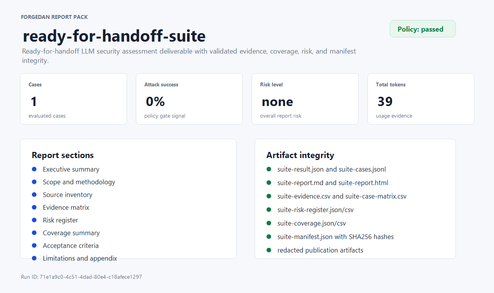
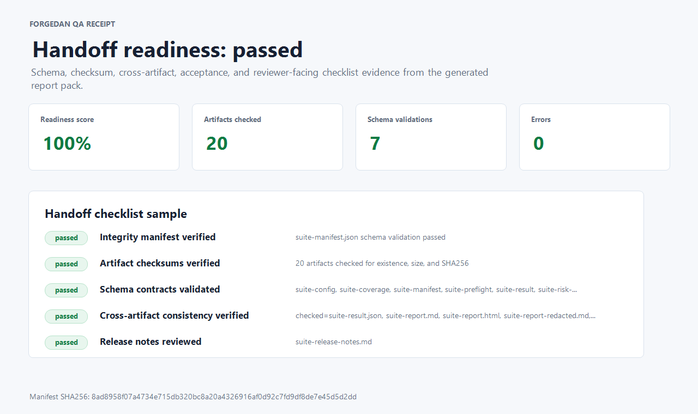
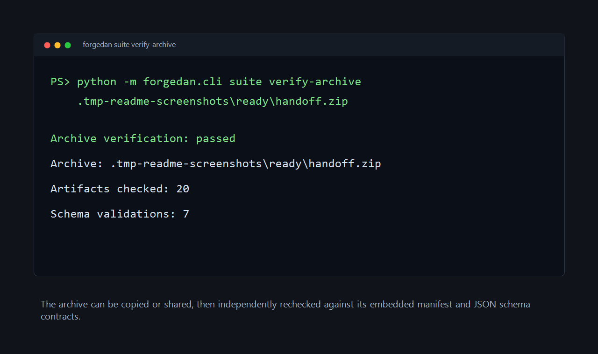

<div align="center">

# FORGEDAN

### Report-first LLM Security Assessment Framework

[](https://www.python.org/downloads/)
[](https://github.com/Coff0xc/LLM-Security-Assessment-Framework/actions/workflows/ci.yml)
[](LICENSE)
[](https://arxiv.org/abs/2511.13548)
[](https://vuejs.org/)
[](docs/sample-report-pack/ready-for-handoff/README.md)


**Reproducible suites | Evidence-rich report packs | QA receipts | Verifiable archives**

[English Version](#en) ·
[Screenshots](#screenshots) ·
[Chinese Version](README.zh-CN.md) ·
[Sample Report Pack](docs/sample-report-pack/ready-for-handoff/README.md)

</div>

---

<a id="en"></a>
This README is the English version of the project documentation. It covers the project positioning, screenshots, quick start, report workflow, artifact list, validation gates, development commands, roadmap, security notes, and license.

Use [README.zh-CN.md](README.zh-CN.md) for Chinese-only handoff or internal sharing.

<a id="en-project-positioning"></a>
### Project Positioning

**FORGEDAN** is based on the paper [*FORGEDAN: An Evolutionary Framework for Jailbreaking Aligned Large Language Models*](https://arxiv.org/abs/2511.13548), but the current project direction has expanded from a jailbreak algorithm demo into a **report-delivery framework for LLM security assessments**.

The repository still contains evolutionary jailbreak attacks, model adapters, WebScan utilities, a REST API, and a Vue dashboard. Its current priority is to produce auditable, reproducible, handoff-ready report packs: YAML suites, deterministic scanners and scorers, evidence matrices, risk registers, coverage summaries, JSON Schema contracts, QA receipts, redacted publication packs, and ZIP archives that can be verified after copying or sharing.

This is a report-delivery project, not a commercial security platform. Its core value is report evidence quality: traceable inputs, reproducible outputs, verifiable artifacts, signed-off handoff, and re-checkable archives.

### Delivery Snapshot

| Topic | Description |
| --- | --- |
| Purpose | Generate reproducible LLM security assessment report packs. |
| Recommended path | `preflight` -> `suite run` -> `validate-report` -> `verify-bundle` -> `qa-report --strict-handoff` -> `archive` -> `verify-archive`. |
| Report evidence | Markdown/HTML reports, JSON/JSONL traces, CSV evidence, case matrix, coverage summary, risk register, release notes, QA receipt, and manifest. |
| Integrity | Schemas, SHA256/size checks, sidecar binding, redaction checks, cross-artifact consistency, and ZIP archive verification protect handoff quality. |
| Sample pack | [Ready-for-handoff sample report pack](docs/sample-report-pack/ready-for-handoff/README.md). |

### Screenshots

The screenshots below come from the checked-in sample generated by `examples/ready-for-handoff-suite.yml`. The rendered sample is available at [docs/sample-report-pack/ready-for-handoff](docs/sample-report-pack/ready-for-handoff/README.md).

#### Report Pack Overview



#### QA Receipt



#### Archive Verification



### Quick Start

#### Prerequisites

| Item | Requirement |
| --- | --- |
| Python | Python >= 3.9 |
| Git | Git is required for cloning the repository and managing local changes. |
| Node.js | Node.js >= 18, only required for the Vue dashboard. |

#### Install

```bash
git clone https://github.com/Coff0xc/LLM-Security-Assessment-Framework.git
cd LLM-Security-Assessment-Framework

# Minimal backend install
pip install -e .

# Web dashboard and WebScan dependencies
pip install -e ".[web]"

# Full provider, web, monitoring, and dev extras
pip install -e ".[all]"

# Frontend
cd frontend
npm install
```

#### Generate a Ready-for-Handoff Report Pack

This is the recommended smoke path: run a no-model preflight, generate the report pack, validate artifacts, write the QA receipt, create a ZIP, and verify the archive after handoff.

```bash
python -m forgedan.cli suite preflight examples/ready-for-handoff-suite.yml --strict --output reports/preflight-ready
python -m forgedan.cli suite run examples/ready-for-handoff-suite.yml --output reports/suite-ready
python -m forgedan.cli suite validate-report reports/suite-ready/suite-result.json
python -m forgedan.cli suite verify-bundle reports/suite-ready/suite-manifest.json
python -m forgedan.cli suite qa-report reports/suite-ready/suite-manifest.json --output reports/suite-ready/qa --strict-handoff
python -m forgedan.cli suite archive reports/suite-ready/suite-manifest.json --output reports/suite-ready/handoff.zip
python -m forgedan.cli suite verify-archive reports/suite-ready/handoff.zip
```

After installing the console script, the same commands can be run as `forgedan suite ...`.

#### Run a Zero-Config Attack Demo

```bash
python -m forgedan.cli run --quick -g "test prompt" -m mock:test
```

#### Run the Web Dashboard

```bash
python -m forgedan.cli web
cd frontend
npm run dev
```

The backend defaults to `:5000`; the frontend defaults to `:5173`.

### Report Workflow

| Step | Description |
| --- | --- |
| 1. Define scope | Define cases, imported evidence sources, report metadata, policy gates, coverage requirements, acceptance criteria, reviewer decisions, and risk-register defaults in a suite YAML file. |
| 2. Run preflight | Run `suite preflight` before spending model budget to catch metadata, scorer, handoff-criteria, provenance, and deterministic replay issues. |
| 3. Generate | Use `suite run` to write raw and redacted JSON/JSONL, Markdown/HTML reports, CSV matrices, coverage, risk register, release notes, and manifest artifacts. |
| 4. Validate locally | Use `validate-report` and `verify-bundle` to bind schemas, hashes, summary counts, redacted artifacts, Markdown/HTML sidecars, and cross-artifact identities back to the source result. |
| 5. Prepare handoff | Use `qa-report --strict-handoff` to write a QA receipt with checklist status, blockers, acceptance criteria, source inventory, schema checks, and reviewer-facing evidence. |
| 6. Archive and re-check | Use `archive` and `verify-archive` to create a single ZIP and re-check it after copying or sharing. |

### Report Pack Artifacts

| Artifact | Audience | Purpose |
| --- | --- | --- |
| `suite-report.md` / `suite-report.html` | Authorized reviewers | Narrative report covering scope, method, findings, coverage, risk, usage, and limitations. |
| `suite-result.json` / `suite-cases.jsonl` | Assessment team | Raw machine-readable results and case traces for audit replay. |
| `suite-evidence.csv` | Reviewers | Finding evidence with taxonomy, confidence, severity rationale, OWASP LLM mapping, and recommendations. |
| `suite-case-matrix.csv` | Reviewers | Case-level result, risk, usage, scorer, metadata, and coverage matrix. |
| `suite-risk-register.json` / `suite-risk-register.csv` | Remediation owners | Risk tracker with owner, status, due date, severity rationale, and evidence fingerprint. |
| `suite-coverage.json` / `suite-coverage.csv` | Reviewers | Coverage by case category, policy domain, taxonomy category, and OWASP LLM category. |
| `suite-config.json` | Assessment team | Normalized suite input snapshot for audit replay. |
| `suite-preflight.json` / `suite-preflight.md` | Assessment team | Readiness audit before model execution. |
| `suite-release-notes.md` | Reviewers | Short handoff notes with risk, acceptance, source inventory, reviewer decisions, artifact pointers, and archive commands. |
| Redacted report/result/cases | External reviewers | Lower-sensitivity publication package with prompts, responses, and evidence redacted. |
| `suite-manifest.json` | Assessment team | Artifact integrity manifest with size, SHA256, schema references, sensitivity, audience labels, and acceptance status. |
| `suite-qa-receipt.json` / `suite-qa-receipt.md` | Assessment lead | Handoff receipt covering manifest, schemas, hashes, consistency checks, preflight, acceptance, risk owners, and limitations. |
| `handoff.zip` | Report recipient | Single-file package that can be re-verified after copying or sharing. |

### JSON Schema and Verification

Report artifact schemas live in [schemas/](schemas/) and support machine validation, handoff acceptance, and CI regression protection.

| Schema | Purpose |
| --- | --- |
| `suite-result.schema.json` | Suite run result. |
| `suite-config.schema.json` | Normalized suite configuration snapshot. |
| `suite-manifest.schema.json` | Report bundle artifact manifest. |
| `suite-comparison.schema.json` | Historical comparison result. |
| `suite-comparison-manifest.schema.json` | Comparison report manifest. |
| `suite-qa-receipt.schema.json` | QA handoff receipt. |
| `suite-preflight.schema.json` | Preflight readiness result. |
| `suite-risk-register.schema.json` | Risk register. |
| `suite-coverage.schema.json` | Coverage summary. |
| `finding-taxonomy.schema.json` | Finding taxonomy. |

`validate-report` checks more than JSON Schema. It recalculates source inventory, usage cost, risk-register totals, coverage totals, comparison regression counts, QA receipt readiness, manifest binding, and Markdown/HTML sidecar summaries so edited reports cannot silently diverge from machine data.

Common verification commands:

```bash
python -m forgedan.cli suite validate-report reports/suite-ready/suite-result.json
python -m forgedan.cli suite verify-bundle reports/suite-ready/suite-manifest.json
python -m forgedan.cli suite qa-report reports/suite-ready/suite-manifest.json --output reports/suite-ready/qa --strict-handoff
python -m forgedan.cli suite verify-archive reports/suite-ready/handoff.zip
```

### Key Capabilities

| Area | What it does |
| --- | --- |
| Report suites | YAML suite definitions, inline or imported cases, replay caches, deterministic seeds, policy gates, and preflight readiness checks. |
| Report artifacts | Markdown/HTML reports, executive summaries, evidence CSVs, case matrices, risk registers, coverage summaries, release notes, and bundle indexes. |
| Evidence integrity | JSON Schemas, artifact manifests, SHA256/size checks, cross-artifact consistency, and redacted-publication leak checks. |
| Handoff QA | QA receipt JSON/Markdown, acceptance criteria, reviewer decisions, owner/due-date tracking, and strict handoff gates. |
| Assessment coverage | Prompt injection, jailbreak roleplay, system prompt leakage, secrets/PII exposure, Agent/MCP/tool policy risk, and model artifact signals. |
| Baseline engine | FORGEDAN, AutoDAN, PAIR, GCG, Crescendo, TAP, model adapters, WebScan, CLI, REST API, and Vue dashboard. |

<a id="en-cli"></a>
### CLI Reference

| Scenario | Command | Notes |
| --- | --- | --- |
| Run a suite | `python -m forgedan.cli suite run examples/smoke-suite.yml` | Generate report outputs from a YAML suite. |
| Per-run output dirs | `python -m forgedan.cli suite run examples/smoke-suite.yml --run-id-dir` | Isolate output directories by run ID. |
| Run preflight | `python -m forgedan.cli suite preflight examples/ready-for-handoff-suite.yml --strict --output reports/preflight-ready` | Check report readiness before spending model budget. |
| Validate report | `python -m forgedan.cli suite validate-report reports/suite-ready/suite-result.json` | Validate schema and semantic consistency. |
| Verify bundle | `python -m forgedan.cli suite verify-bundle reports/suite-ready/suite-manifest.json` | Verify manifest, hashes, sidecars, and cross-artifact consistency. |
| Write QA receipt | `python -m forgedan.cli suite qa-report reports/suite-ready/suite-manifest.json --output reports/suite-ready/qa --strict-handoff` | Write a strict handoff QA receipt. |
| Create ZIP | `python -m forgedan.cli suite archive reports/suite-ready/suite-manifest.json --output reports/suite-ready/handoff.zip` | Create a single-file handoff package. |
| Verify ZIP | `python -m forgedan.cli suite verify-archive reports/suite-ready/handoff.zip` | Re-check the archive after copying or sharing. |
| Compare results | `python -m forgedan.cli suite compare base.json current.json --output comparison.json --fail-on-regression` | Generate historical comparison and optionally fail on regressions. |
| Export taxonomy | `python -m forgedan.cli suite taxonomy --json` | Export the finding taxonomy. |
| Export schemas | `python -m forgedan.cli suite schemas --json` | Export report artifact schema references. |
| Attack demo | `python -m forgedan.cli run --quick -g "test prompt" -m mock:test` | Run a zero-config demo with the mock model. |
| Web backend | `python -m forgedan.cli web` | Start the API/web backend. |

### Attack Methods

| Method | Type | Description | Paper |
| --- | --- | --- | --- |
| FORGEDAN | Evolutionary | Multi-level mutation with semantic fitness and dual judge. | [arXiv:2511.13548](https://arxiv.org/abs/2511.13548) |
| AutoDAN | Evolutionary | Hierarchical genetic algorithm for stealthy jailbreak prompts. | [ICLR 2024](https://arxiv.org/abs/2310.04451) |
| PAIR | LLM-iterative | Black-box jailbreak via attacker-target LLM iteration. | [NeurIPS 2024](https://arxiv.org/abs/2310.08419) |
| GCG | Gradient-free | Greedy coordinate adversarial suffix generation. | [ICML 2023](https://arxiv.org/abs/2307.15043) |
| Crescendo | Multi-turn | Gradual escalation from benign to harmful content. | [USENIX Security 2025](https://arxiv.org/abs/2404.01833) |
| TAP | Tree search | Tree-of-thought attack with pruning and multi-LLM collaboration. | [NeurIPS 2024](https://arxiv.org/abs/2312.02119) |

### Model Adapters

| Provider | Models | Example |
| --- | --- | --- |
| OpenAI | GPT-3.5, GPT-4, GPT-4o | `openai:gpt-4` |
| Anthropic | Claude 3 Opus/Sonnet/Haiku | `anthropic:claude-3-opus` |
| Google | Gemini Pro, Gemini Vision | `gemini:gemini-pro` |
| DeepSeek | DeepSeek Chat/Coder | `deepseek:deepseek-chat` |
| Zhipu | GLM-4, GLM-3 | `zhipu:glm-4` |
| Qwen | Qwen Max/Plus | `qwen:qwen-max` |
| Moonshot | Kimi | `moonshot:moonshot-v1-8k` |
| Yi | Yi Large/Medium | `yi:yi-large` |
| Baichuan | Baichuan 4/3 | `baichuan:baichuan-4` |
| Ollama | Local Ollama models | `ollama:llama2` |
| vLLM | Local vLLM services | `vllm:model-name` |
| HuggingFace | HuggingFace models | `huggingface:model-name` |
| Mock | Local testing, no API key | `mock:test-model` |

### WebScan Modes

| Mode | Description | Use Case |
| --- | --- | --- |
| URL crawler | Async crawling plus title, form, link, and script extraction. | Gather attack material from target websites. |
| Security scanner | XSS, SQLi, directory traversal, security headers, and HTTP methods. | Traditional web vulnerability assessment. |
| LLM interaction test | Indirect prompt injection via web content and evolutionary optimization. | Test LLM safety when processing web content. |

### Architecture

```text
forgedan/
├── suite.py              # Suite runner, artifacts, validators, QA, archive verifier
├── scanners.py           # Deterministic prompt, response, tool, model-artifact scanners
├── scorers.py            # Reusable deterministic suite scorers
├── finding_taxonomy.py   # Finding IDs, priorities, OWASP LLM mappings
├── attacks/              # Attack algorithms and registry
├── adapters/             # Hosted, local, Chinese, vision, vLLM, HuggingFace, mock adapters
├── api/                  # Flask Blueprint REST API
├── webscan/              # Crawler, web scanner, LLM interaction tester
├── engine.py             # Evolutionary algorithm engine
├── mutator.py            # Mutation strategies and MAB selection
├── fitness.py            # Semantic fitness evaluation
└── judge.py              # Dual-judge mechanism

schemas/                  # Report artifact JSON Schema contracts
examples/                 # Runnable suites and fixtures
docs/                     # Landscape, lint roadmap, sample report pack
tests/                    # pytest coverage
frontend/                 # Vue 3 SPA dashboard
```

`forgedan/suite.py` is the report-delivery entry point. It handles suite execution, report artifact writing, schema/manifest validation, QA receipts, and archive verification. `schemas/` defines artifact contracts, `examples/` stores runnable fixtures, `docs/` keeps sample report packs and project documentation, and `frontend/` contains the Vue 3 dashboard.

### API Endpoints

The backend exposes a Flask Blueprint REST API for automation scripts, demos, and internal assessment workflows.

```text
POST   /api/attacks/run
GET    /api/attacks/{id}/status
GET    /api/attacks/{id}/result
POST   /api/attacks/{id}/stop

GET    /api/models/providers
POST   /api/models/test

POST   /api/webscan/crawl
POST   /api/webscan/scan
POST   /api/webscan/llm-test

POST   /api/reports/generate
GET    /api/reports/{id}
GET    /api/reports/{id}/download

GET    /api/datasets
POST   /api/datasets/upload

GET    /api/health
GET    /api/metrics
```

### Documentation Map

| Document | Purpose |
| --- | --- |
| [docs/sample-report-pack/ready-for-handoff/](docs/sample-report-pack/ready-for-handoff/README.md) | Checked-in mock report pack with QA receipt and verified ZIP archive. |
| [docs/llm-security-landscape.md](docs/llm-security-landscape.md) | Competitor scan, gaps, and optimization priorities. |
| [docs/lint-roadmap.md](docs/lint-roadmap.md) | Current CI lint gate, measured lint debt, and promotion plan. |
| [docs/repository-about.md](docs/repository-about.md) | Repository sidebar wording and topic recommendations. |
| [schemas/](schemas/) | JSON Schema contracts for report artifacts. |
| [examples/](examples/) | Runnable suites, case fixtures, MCP manifests, and model artifact fixtures. |

### Development

```bash
pip install -e ".[dev]"

# Full pytest suite used locally
python -m pytest -q -W error::DeprecationWarning -p no:cacheprovider --basetemp .tmp-test

# CI report-pack gates
python -m forgedan.cli suite run examples/ready-for-handoff-suite.yml --output reports/suite-ready
python -m forgedan.cli suite verify-bundle reports/suite-ready/suite-manifest.json
python -m forgedan.cli suite qa-report reports/suite-ready/suite-manifest.json --output reports/suite-ready/qa --strict-handoff
python -m forgedan.cli suite verify-archive reports/suite-ready/handoff.zip

# Selected flake8 gate
python -m flake8 forgedan/ --select=E9,F63,F7,F82,E722,F401,F841 --show-source --statistics

# Formatter gate
python -m black --check forgedan tests

# Frontend build
cd frontend
npm install
npm run build
```

### Roadmap

- [x] Evolutionary engine and mutation strategies
- [x] Six attack methods: FORGEDAN, AutoDAN, PAIR, GCG, Crescendo, TAP
- [x] Hosted, Chinese, local, vLLM, HuggingFace, vision, and mock adapters
- [x] YAML suite runner with imported cases, custom scorers, response cache, source inventory, and policy gates
- [x] Prompt injection, jailbreak framing, system prompt leakage, secrets/PII, Agent/MCP/tool policy risk, and model artifact scanning
- [x] Markdown/HTML reports, redacted publication packs, evidence matrices, case matrices, risk registers, coverage summaries, release notes, and bundle indexes
- [x] JSON Schema contracts, semantic validation, manifest verification, QA receipts, and archive verification
- [x] Checked-in ready-for-handoff sample report pack with screenshots
- [x] CI gates for tests, report-pack validation, strict QA handoff, archive verification, selected flake8, Black, and frontend build
- [ ] Add more realistic Agent/MCP manifest fixtures and calibrate the default trust-score policy
- [ ] Add HarmBench/JailbreakBench examples only where they improve report evidence quality
- [ ] Expand model serialization analysis when the report scope needs deeper artifact review

### GitHub About

Suggested repository description:

> Report-first LLM security assessment framework for reproducible red-team suites, evidence packs, QA receipts, schemas, and archive verification.

Suggested topics:

`llm-security`, `ai-red-team`, `prompt-injection`, `jailbreak`, `owasp-llm`, `mcp-security`, `agent-security`, `security-reporting`, `risk-register`, `audit-evidence`, `json-schema`, `pytest`, `python`

### Citation

If you use FORGEDAN in research, please cite:

```bibtex
@article{cheng2025forgedan,
  title={FORGEDAN: An Evolutionary Framework for Jailbreaking Aligned Large Language Models},
  author={Cheng, Siyang and Liu, Gaotian and Mei, Rui and Wang, Yilin and Zhang, Kejia and Wei, Kaishuo and Yu, Yuqi and Wen, Weiping and Wu, Xiaojie and Liu, Junhua},
  journal={arXiv preprint arXiv:2511.13548},
  year={2025}
}
```

### Contributing

Contributions are welcome. When changing report behavior, keep report artifacts, schemas, tests, and documentation aligned. See [CONTRIBUTING.md](CONTRIBUTING.md) for the general contribution flow.

### Security

Use this project only for authorized security testing, research reproduction, and report delivery. Raw prompts, responses, traces, caches, and evidence may contain sensitive data; handle them according to the assessment scope and handoff rules.

### License

This project is released under the MIT License. See [LICENSE](LICENSE).

---

<div align="center">

**Built by [Coff0xc](https://github.com/Coff0xc)**

[Report Bug](https://github.com/Coff0xc/LLM-Security-Assessment-Framework/issues) ·
[Request Feature](https://github.com/Coff0xc/LLM-Security-Assessment-Framework/issues)

</div>
